# DER – Bodegas del Atuel (TPI Bases de Datos)

Diagrama entidad-relación completo (28 tablas). Se renderiza en GitHub, GitLab, VS Code (extensión Markdown Preview Mermaid), Obsidian y https://mermaid.live

Leyenda: `PK` clave primaria · `FK` clave foránea · `UK` única.

## Diagrama completo

```mermaid
erDiagram
  localidad ||--o{ sala_venta : ubica
  localidad ||--o{ cliente : "domicilia a"
  localidad ||--o{ transportista_localidad : cubre
  sala_venta ||--o{ empleado : emplea
  sala_venta ||--o{ comprobante : emite
  sala_venta ||--o{ stock_sala : almacena
  sala_venta ||--o{ transferencia : solicita

  finca ||--o{ parcela : tiene
  cepa ||--o{ parcela : "se planta en"
  parcela ||--o{ lote_uva : origina
  bodega ||--o{ lote_uva : recibe
  lote_uva ||--o{ analisis_calidad : tiene

  bodega ||--o{ vino : produce
  bodega ||--o{ ingreso : entrega
  vino ||--o{ composicion_vino : "se compone de"
  cepa ||--o{ composicion_vino : participa
  vino ||--o{ vino_maridaje : combina
  maridaje ||--o{ vino_maridaje : "sugerido en"
  vino ||--o{ auditoria_precio : audita
  vino ||--o| stock_deposito : "stock en deposito"
  vino ||--o{ stock_sala : "stock en sala"

  cliente ||--o| cliente_socio : "es socio"
  cliente ||--o| cliente_distribuidor : "es distribuidor"
  cliente ||--o| cliente_exportador : "es exportador"
  cliente_exportador ||--o{ permiso_exportacion : posee
  cliente ||--o{ comprobante : recibe
  comprobante ||--o{ renglon_comprobante : detalla
  vino ||--o{ renglon_comprobante : "se vende en"

  transportista ||--o{ transportista_localidad : cubre
  transportista ||--o{ ingreso : traslada
  ingreso ||--o{ renglon_ingreso : detalla
  vino ||--o{ renglon_ingreso : ingresa
  transferencia ||--o{ renglon_transferencia : detalla
  vino ||--o{ renglon_transferencia : transfiere

  localidad {
    int id_localidad PK
    varchar codigo_postal
    varchar nombre
    varchar provincia
    varchar encargado_regional
  }
  sala_venta {
    int id_sala PK
    varchar calle
    varchar numero
    dia_semana dia_cierre
    int id_localidad FK
  }
  empleado {
    char cuit PK
    varchar nombre
    date fecha_ingreso
    numeric salario
    int id_sala FK
  }
  finca {
    int id_finca PK
    varchar nombre UK
    numeric superficie_ha
    varchar departamento
    varchar provincia
  }
  cepa {
    int id_cepa PK
    varchar nombre UK
    tipo_cepa tipo
  }
  parcela {
    int id_finca PK, FK
    int nro_parcela PK
    numeric superficie_ha
    smallint anio_plantacion
    int id_cepa FK
  }
  bodega {
    char cuit PK
    varchar razon_social UK
    varchar domicilio
  }
  lote_uva {
    int nro_lote PK
    int id_finca FK
    int nro_parcela FK
    smallint campana
    date fecha_cosecha
    numeric kg_cosechados
    char cuit_bodega FK
  }
  analisis_calidad {
    int id_analisis PK
    int nro_lote FK
    date fecha
    numeric grado_brix
    numeric ph
    numeric acidez_total
  }
  vino {
    int cod_vino PK
    varchar nombre
    tipo_vino tipo
    smallint anada
    int volumen_ml
    numeric graduacion
    numeric precio
    char cuit_bodega FK
  }
  composicion_vino {
    int cod_vino PK, FK
    int id_cepa PK, FK
    numeric porcentaje
  }
  maridaje {
    int id_maridaje PK
    varchar nombre UK
    smallint temperatura_servicio
  }
  vino_maridaje {
    int cod_vino PK, FK
    int id_maridaje PK, FK
  }
  cliente {
    int id_cliente PK
    tipo_cliente_enum tipo_cliente
    varchar nombre_razon_social
    varchar tipo_documento
    varchar nro_documento
    varchar direccion
    int id_localidad FK
    date fecha_alta
    numeric descuento_pct
  }
  cliente_socio {
    int id_cliente PK, FK
    tipo_cliente_enum tipo_cliente
  }
  cliente_distribuidor {
    int id_cliente PK, FK
    tipo_cliente_enum tipo_cliente
    varchar zona_cobertura
    varchar nro_habilitacion UK
  }
  cliente_exportador {
    int id_cliente PK, FK
    tipo_cliente_enum tipo_cliente
    varchar pais_destino_principal
  }
  permiso_exportacion {
    varchar codigo PK
    int id_exportador FK
    date fecha_emision
    date fecha_vencimiento
  }
  comprobante {
    int nro_comprobante PK
    date fecha
    int id_cliente FK
    int id_sala FK
    numeric subtotal
    numeric descuento
    numeric total
  }
  renglon_comprobante {
    int nro_comprobante PK, FK
    int cod_vino PK, FK
    int cantidad
    numeric precio_unitario
    numeric descuento_pct
    numeric subtotal
  }
  transportista {
    int cod_transportista PK
    varchar razon_social
    char cuit UK
    varchar email
    varchar telefono
    varchar domicilio
  }
  transportista_localidad {
    int cod_transportista PK, FK
    int id_localidad PK, FK
  }
  stock_deposito {
    int cod_vino PK, FK
    int cantidad
  }
  stock_sala {
    int id_sala PK, FK
    int cod_vino PK, FK
    int cantidad
  }
  ingreso {
    int cod_ingreso PK
    date fecha
    estado_documento estado
    int cod_transportista FK
    char cuit_bodega FK
  }
  renglon_ingreso {
    int cod_ingreso PK, FK
    int cod_vino PK, FK
    int cantidad
  }
  transferencia {
    int nro_solicitud PK
    int id_sala FK
    date fecha_confeccion
    estado_documento estado
  }
  renglon_transferencia {
    int nro_solicitud PK, FK
    int cod_vino PK, FK
    int cantidad
  }
  auditoria_precio {
    int id_auditoria PK
    int cod_vino FK
    numeric precio_anterior
    numeric precio_nuevo
    timestamptz fecha_hora
    varchar usuario
  }
```

## Tipos enumerados

| Enum | Valores |
|---|---|
| `estado_documento` | en_confeccion, terminado, procesado |
| `tipo_vino` | tinto, blanco, rosado, espumante |
| `tipo_cepa` | tinta, blanca |
| `tipo_cliente_enum` | socio, distribuidor, exportador |
| `dia_semana` | lunes, martes, miercoles, jueves, viernes, sabado, domingo |

## Notas de modelado

- **Jerarquía de clientes:** `cliente` es la superclase; `cliente_socio`, `cliente_distribuidor` y `cliente_exportador` son subtipos con relación 1 a 0..1 (el `id_cliente` es PK y FK a la vez).
- **Claves compuestas:** `parcela` (id_finca, nro_parcela), `composicion_vino`, `vino_maridaje`, `renglon_*`, `stock_sala` y `transportista_localidad`.
- **FK compuesta:** `lote_uva (id_finca, nro_parcela)` referencia a `parcela (id_finca, nro_parcela)`.
- **Relación 1 a 1:** `stock_deposito` tiene como PK `cod_vino`, que referencia a `vino`.
- **Documentos con estado:** `ingreso` y `transferencia` usan `estado_documento`.
- **Auditoría:** `auditoria_precio` registra cambios de `vino.precio` (precio anterior y nuevo, fecha/hora y usuario).
